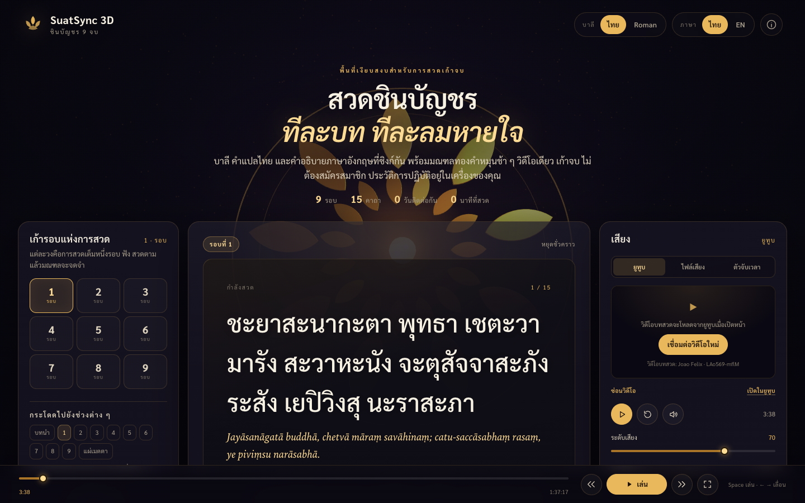
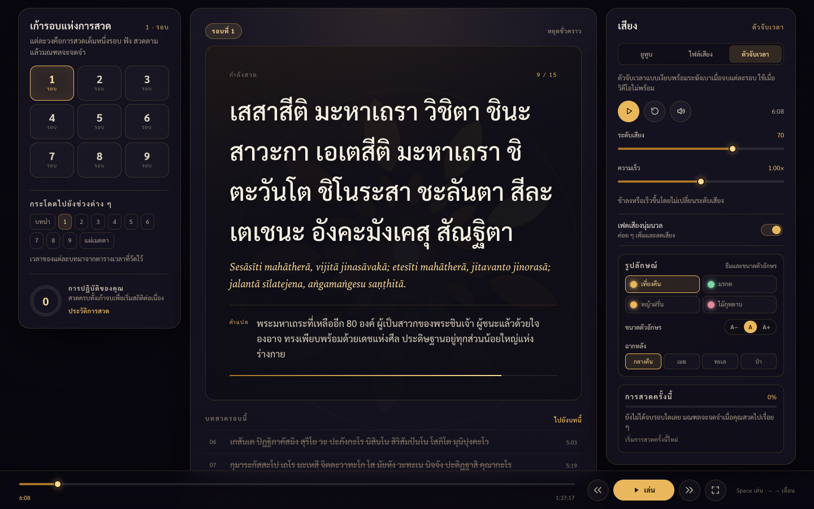
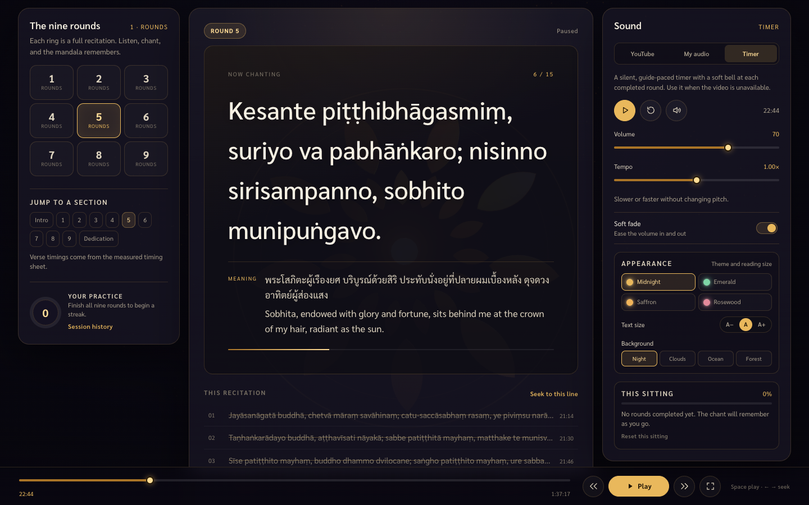
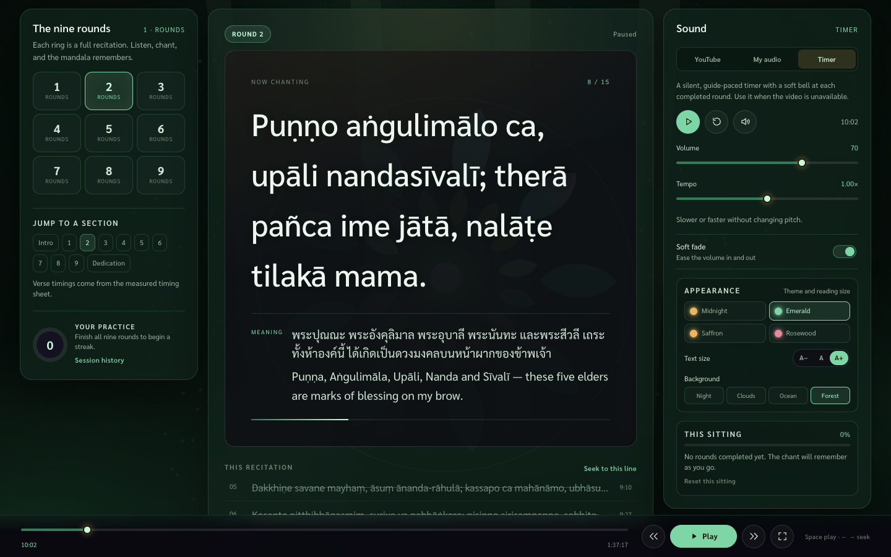
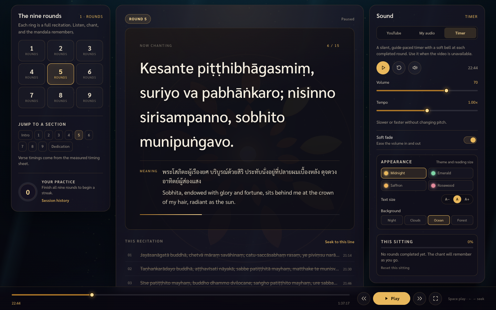
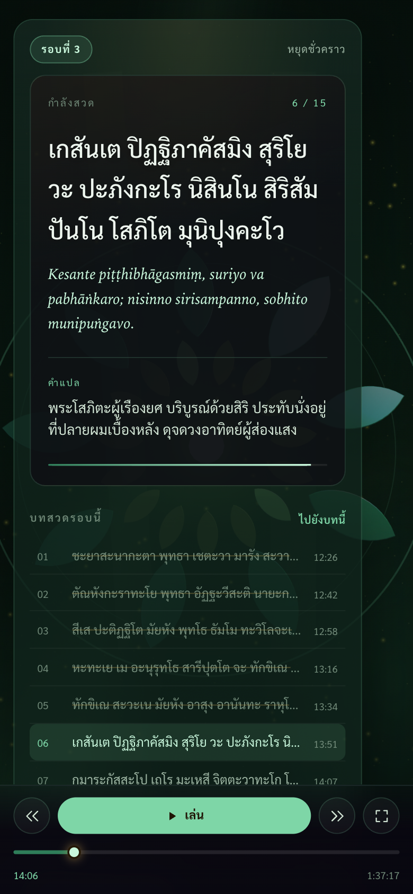

# SuatSync 3D

**Chinabunchorn 9 Recitations — Chanting & Karaoke Studio**

A single-page, bilingual studio for chanting the Chinabunchorn Chant (พระคาถาชินบัญชร) nine times.
Large Pali lines, Thai meaning and English gloss stay in step with a YouTube chant video — or with
your own audio file, or a silent guide timer. A slow golden lotus mandala turns behind the text and
keeps a petal for every round you finish.

[**Open the studio →**](https://somphol.github.io/suatsync-3d/)

[](https://somphol.github.io/suatsync-3d/)

No account. No build step. No analytics. Practice history stays in your browser.

---

## What it does

- **Measured verse timings.** The 15 cue points for Round 1 are measured, and the same relative pattern is spaced across all nine rounds. Edit `data/timings.csv` to refine them.
- **Starts at Round 1, verse 1.** The studio opens on the chant rather than the intro; the intro and dedication remain one click away.
- **Nine full recitations.** Fifteen Chinabunchorn verses per round, with the Namo, the traditional
  homage and a dedication (แผ่เมตตา) at the close.
- **Karaoke that follows the sound.** The active line grows brighter as it plays; click any line to
  jump to its timestamp.
- **Three sound sources.** The YouTube video loads on start, a local MP3/M4A/OGG, or a silent guide
  timer with a soft bell at each completed round.
- **Four themes, three reading sizes, four animated backdrops.** Midnight, Emerald, Saffron and
  Rosewood; small/medium/large chant text; night, clouds, ocean or forest atmosphere. All saved
  locally.
- **A practice that remembers.** Round completion, full sittings, day streaks, lifetime minutes and a
  private JSON export.
- **Bilingual, dual-script.** Thai or English interface; Thai Pali script or Roman transliteration;
  Thai meaning always available, with an English gloss in English mode.
- **Made to be read.** High contrast, generous type, focus mode, keyboard controls, reduced-motion
  support and a print view of the full chant.



## Quick start

There is nothing to install and nothing to compile.

```bash
git clone https://github.com/somphol/suatsync-3d.git
cd suatsync-3d
python3 -m http.server 8080
# open http://localhost:8080/
```

`npm start` runs the same server. Opening `index.html` directly with `file://` mostly works, but the
YouTube IFrame API requires an `http(s)` origin, so use a local server for video playback.

### First chant

1. The YouTube player loads when the page opens. Choose **YouTube**, **My audio** or **Timer** in the Sound panel.
2. Press **Play**. If YouTube is blocked, use **Reconnect video**, the timer, or a local file.
3. Chant the highlighted line. The list below shows the rest of the round; click a line to seek.
4. Finish all nine rounds. The mandala lights one petal per round and records the sitting.

## Features

### Sound

| Control | Behaviour |
| --- | --- |
| Play / pause | Fades the volume in and out when Soft fade is on |
| Restart | Returns to 0:00 without changing the play state |
| Volume | 0–100, applied to YouTube or the local audio element |
| Tempo | 0.75×–1.25×, pitch preserved (`setPlaybackRate` / `playbackRate`) |
| Mute | Fades to silence and back |
| My audio | Plays a local file via an object URL; it never leaves the tab |
| Timer | A silent media clock with an optional completion chime |

### Karaoke and timings

The timeline is a set of eleven markers: intro, rounds 1–9, dedication. Inside a section, each line
receives a slice of time proportional to its Pali length. That makes the dataset portable and lets the
same verses stretch or compress with the audio.

Default markers assume the source video's measured length of **5,837 seconds (1:37:17)**. Round 1
starts at **3:38**, round 2 at **8:02**, and the spacing is 4:24 per round. Timings are not chapter data
from the video; they are the measured verse sheet plus the same relative pattern for later rounds.

For precise verse-level sync, edit [`data/timings.csv`](data/timings.csv) and run
`npm run timings`. The sheet holds all 135 cues (9 rounds × 15 verses) and lets you set the exact
start of every verse. `timings.js` is generated from it. See [data/README.md](data/README.md).

### Progress

- A round is marked complete only after at least 50% of it has actually played and the playhead
  reaches its end. Seeking straight to the end does not count.
- Finishing all nine rounds records a sitting, updates the streak and opens a summary.
- Streaks are consecutive calendar days with a completed nine-round sitting.
- `Reset this sitting` clears the current nine rounds without touching history.
- **Session history → Export JSON** downloads settings, totals and sittings.

### The mandala

The 3D scene is generated at runtime with Three.js r128: a gold lotus mandala of nine outer petals
(one per round), fifteen inner petals (one per verse), concentric rings, an emissive core, a soft glow
sprite and 460 additive particles. It rotates slowly, breathes with the audio analyser when a local
file is playing, and lights a petal when a round is completed. YouTube audio is cross-origin and cannot
be analysed; in that mode the pulse is a gentle synthetic envelope. Reduced-motion preferences stop
the rotation.

The **Background** control layers a second animated scene behind the mandala: drifting cloud banks,
rising ocean bubbles and light shafts, or forest fireflies and mist. Each theme also recolours the
mandala, rings, glow and particles.

## Controls

| Key | Action |
| --- | --- |
| `Space` | Play / pause |
| `←` / `→` | Seek 5 seconds (`Shift` = 30 seconds) |
| `M` | Mute / unmute |
| `F` | Focus mode |
| `Esc` | Close the open dialog |

## Screenshots

| Roman + English | Forest theme | Ocean backdrop | Mobile |
| --- | --- | --- | --- |
|  |  |  |  |

## Verification

The release ships with two dependency-free checks.

```bash
node scripts/check.mjs                 # static contract: files, links, syntax, dataset, hygiene
node scripts/verify-browser.mjs        # headless Chrome: 27 self-tests + DOM + interactions
node scripts/verify-browser.mjs --screenshots   # also refreshes docs/screenshot-*.png
```

`check.mjs` prints `OK <n> checks`. `verify-browser.mjs` starts its own server and exits 0 only when
the in-app tests, DOM checks, timer transport and console-error scan all pass. Node 22+ and
Chrome/Chromium are required; set `CHROME_PATH` if Chrome is not in the usual place.

The last verified run is recorded in [docs/TESTING.md](docs/TESTING.md) and
[docs/BUILD-STATE.md](docs/BUILD-STATE.md).

## Project layout

```text
index.html                 structure, dialogs, bilingual hooks
style.css                  design tokens, layout, responsive, print
script.js                  dataset, i18n, timeline, audio, renderer, 3D, tests
timings.js                 generated per-verse cue times (load before script.js)
data/timings.csv           editable 9 × 15 timing sheet
data/README.md             how to measure and rebuild timings
docs/                      architecture, reproduction, content, testing, deployment
scripts/build-timings.mjs  CSV → timings.js, with validation
scripts/check.mjs          static release contract
scripts/verify-browser.mjs headless verification and screenshots
state.json                 build record: time, tokens, verification
```

There is no bundler, framework, backend or service worker. Three.js is the only runtime dependency and
is loaded from cdnjs; the app degrades to a static, readable karaoke surface without it.

## Deploy

GitHub Pages serves the repository root. Push `main`, then confirm the Pages build.

```bash
git push origin main
```

See [docs/DEPLOYMENT.md](docs/DEPLOYMENT.md) for repository creation, Pages API settings, cache
behaviour and the post-deploy smoke test.

## Documentation

- [docs/REPRODUCTION.md](docs/REPRODUCTION.md) — the rebuild book for another engineer or agent
- [docs/ARCHITECTURE.md](docs/ARCHITECTURE.md) — runtime map and state schema
- [docs/CONTENT.md](docs/CONTENT.md) — chant edition, translations, timing model
- [docs/TESTING.md](docs/TESTING.md) — what was run and what it proved
- [docs/DEPLOYMENT.md](docs/DEPLOYMENT.md) — Pages operations
- [docs/DESIGN.md](docs/DESIGN.md) — visual and interaction system
- [AGENTS.md](AGENTS.md) — handoff for the next agent
- [CONTRIBUTING.md](CONTRIBUTING.md) · [SECURITY.md](SECURITY.md) · [CHANGELOG.md](CHANGELOG.md)

## Credits

- Chant text: traditional Thai Pali recension, reproduced from Thai Wikisource (CC BY-SA 4.0); Thai
  and English glosses written for this project.
- Video: [Joao Felix — Chinabunchorn 9 recitations](https://www.youtube.com/watch?v=LAo569-mflM),
  embedded, never re-hosted.
- Built with [OpenCode](https://opencode.ai/) and **DeepSeek V4.1 Flash**.
- Three.js r128 (MIT).

## Licence

Code, interface and original glosses: **MIT**. Chant transcription: CC BY-SA 4.0. Video: all rights
with its creator. See [LICENSE](LICENSE) and [ATTRIBUTION.md](ATTRIBUTION.md).
